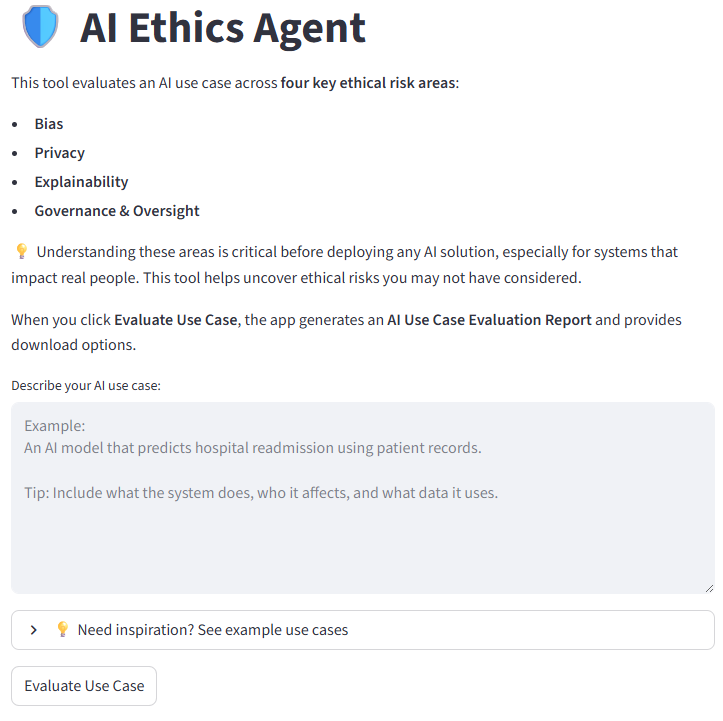

# AI Ethics Agent
👉 **Try the Live App:** [ai-ethics-agent.streamlit.app](https://ai-ethics-agent.streamlit.app)

The **AI Ethics Agent** is an agentic application that helps you **evaluate the ethical implications of AI use cases**.

It analyzes AI ideas across **four core ethical risk categories**:

- **Bias**
- **Privacy**
- **Explainability**
- **Governance & Oversight**

This tool is designed to be:
- Useful for **practitioners** exploring real AI use cases
- Clear and accessible for **non-experts**
- A practical **demo of agentic AI workflows**

---

## Why This Exists

Teams often get excited about *what AI can do* — and only later discover:
- biased outcomes,
- privacy violations,
- lack of explainability,
- or governance failures that require rollbacks, fines, or reputational repair.

This agent is meant to act as a **pause button**:

> *“What ethical risks might we be missing — and how should we think about them now?”*

---

## What the Agent Does

1. **You describe an AI use case**  
   (e.g., “An AI system that screens resumes for hiring decisions.”)

2. A **planning agent** analyzes the use case and:
   - selects relevant ethical categories,
   - determines evaluation depth per category,
   - optionally suggests follow-up questions.

3. The agent evaluates the use case across:
   - Bias  
   - Privacy  
   - Explainability  
   - Governance & Oversight  

4. It generates a concise, structured **AI Use Case Evaluation Report** that includes:
   - Ethical context for each category
   - Key risks specific to the use case
   - Practical mitigation considerations
   - Relevant **references & further reading**

5. You can:
   - view the report directly in the app,
   - download it as **Markdown (.md)** or **HTML (.html)**.

---


## Preview

  


---

## Technologies Used

- **Streamlit** — interactive user interface  
- **LangChain** — agent orchestration  
- **OpenAI API** — LLM reasoning (`gpt-4o-mini`)  
- **Python Markdown** — HTML report generation  

---

## Local Setup (Advanced Users)

Clone the repo and run locally:

```bash
# Clone the repo
git clone https://github.com/dandersonghub/AI-Ethics-Agent.git
cd AI-Ethics-Agent

# Install uv if not already installed
pip install uv

# Create virtual environment and install packages
uv venv
uv pip install -r requirements.txt

# Set your OpenAI API key
echo OPENAI_API_KEY="sk-..." > .env

# Run the app
streamlit run streamlit_app.py
```

---

## Repo Structure

```
ai-ethics-agent/
├── agent.py              # Agent orchestration logic
├── workflow/             # Planner & agent components
├── streamlit_app.py      # Streamlit frontend
├── prompts.yaml          # Structured ethics prompts
├── reports/              # Generated reports (.md)
├── requirements.txt      # Runtime dependencies
├── .gitignore            # Excludes .env, .venv, reports, etc.
├── README.md             # You're reading it!
```

---

## Feedback & Discussion

This project is intended to spark reflection and discussion around ethical AI use cases.

If you have feedback, questions, or ideas for improvement, feel free to open an issue or explore the codebase.
